<picture>
  <source media="(prefers-reduced-motion: reduce)" srcset="assets/profile-static.svg">
  
</picture>

Lire la version texte

**Ingénieur pédagogique, chef de projet et développeur**

Je pars des besoins et des usages, en tenant compte des orientations de l’établissement. J’associe les acteurs du projet pour clarifier les attentes, les contraintes et les responsabilités, aligner les priorités et cadrer le travail.

Je construis ensuite des prototypes avec les équipes pour confronter les choix au terrain. La solution prend la forme adaptée au besoin : un parcours de formation, une application métier, une plateforme de données ou des outils pour agents IA.

**Mon fil conducteur : comprendre comment ça fonctionne, puis rendre l’action accessible simplement.**

## Concevoir avec les équipes

Je travaille dans l’enseignement supérieur, au contact des équipes et de leurs pratiques. Mon expérience en ergonomie, en UX et en formation nourrit mes choix de développement : les parcours dans l’interface, les règles métier, les explications et la prise en main.

**J’itère au quotidien avec les utilisateurs.** Les retours d’usage servent à corriger, simplifier et faire évoluer les outils.

## Projets phares

### iStage · Application pédagogique

J’ai refondu et fait évoluer **iStage**, une plateforme de suivi et d’évaluation des stages utilisée par plus de 100 enseignants pour accompagner plus de 200 étudiants. J’y ai articulé les besoins pédagogiques et administratifs : grilles d’évaluation versionnées, notation par compétences, rapports PDF et accès adaptés aux responsabilités de chacun.

Les dernières évolutions étendent ce travail à un annuaire partagé des établissements et tuteurs, au suivi individuel des stages et à la génération et au circuit de signature des conventions.

### Intra-ILEPS · Self-service et espace intervenant

J’ai réalisé **le self-service, l’onboarding et l’espace intervenant**. Ces fonctionnalités s’inscrivent dans Intra-ILEPS, un backoffice et intranet pour les équipes ILEPS.

### Unified Data · iPaaS & référentiel de données

Un socle d’unification des données et d’intégration entre logiciels métier, combinant une approche **MDM** pour les référentiels et **iPaaS** pour les échanges. Il rapproche et normalise les données, puis les expose via des APIs et des connecteurs réutilisables par les applications et services qui en ont besoin.

Le projet articule APIs REST et SOAP, référentiels partagés et workflows d’intégration.

### Moodle MCP & Entra Ops · Outils pour agents IA

Des outils pour permettre à des agents d’intervenir sur Moodle et Microsoft. Leur conception traite les droits, les périmètres d’action et la vérification des opérations : selon l’outil, journaux, approbations ou mécanismes d’annulation adaptés.

## Aussi dans l’atelier

- **Tuteur IA formatif** : recueillir des observations étayées par les réponses de l’apprenant et vérifier le comportement du modèle.
- **Jeux de données d’exercice** : générer des données cohérentes pour construire des activités d’analyse.
- **Planification d’oraux** : organiser des créneaux sous contraintes et rendre les conflits visibles.

## Cas concret · L’espace intervenant

Sur les 2 premiers mois de mise en production, l’espace intervenant gère l’onboarding et la rémunération de **193 intervenants actifs**, dont **145 vacataires** et **32 auto-entrepreneurs**, pour environ **4 200 heures de cours**.

Des processus partagés couvrent les étapes communes, avec des parcours différenciés selon les statuts.

## Environnement technique

| Langages | Applications & données | Intégration & agents |
| --- | --- | --- |
| Python · TypeScript · PHP · SQL | Next.js · FastAPI · MongoDB | REST · SOAP · MCP · Microsoft Graph |

## Activité GitHub

---

**Comprendre les usages. Concevoir avec les équipes. Faire évoluer les outils.**

